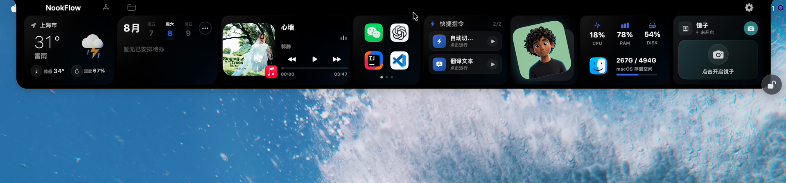

# MacBook 的刘海不该只用来“占地方”，所以我做了 NookFlow

买了带刘海的 MacBook 以后，我一直觉得有点可惜：这块区域始终在视线最上方，却很少真正参与工作。

看天气要打开组件，记待办要切到提醒事项，切歌要找到播放器，临时中转文件又要翻 Finder。每次操作都不复杂，但一天重复几十次，思路就是这样被打断的。

所以我做了 **NookFlow**——一款放在 Mac 顶部的轻量级灵动岛应用。

*天气、待办、音乐、快捷应用、快捷指令和设备状态，都可以集中在 Mac 顶部。*

## 一个入口，装下常用工作流

NookFlow 平时安静地收在屏幕顶部，需要时才展开。目前包含：

- 天气、体感温度和湿度
- 待办管理，并与 Apple 提醒事项同步
- 音乐封面、播放进度和播放控制
- 菜单栏、顶部胶囊、桌面三种歌词
- 常用应用和系统快捷指令
- 文件暂存、存入文稿和隔空投送
- CPU、内存和磁盘状态
- 临时图片固定与镜子预览

它不是要把桌面变成一个复杂的仪表盘，而是让常用信息在需要时出现，不用时退回视线边缘。

## 歌词不必再占一个窗口

NookFlow 可以把歌词放在菜单栏、顶部胶囊或桌面上。工作时使用菜单栏模式，想跟唱时再切换到更醒目的显示方式。

*歌词出现在合适的位置，而不是一直挡在眼前。*

## 文件拖到顶部，就能继续处理

拖动文件靠近顶部时，NookFlow 会自动进入接收状态。文件可以临时存放，也可以直接存入文稿或通过隔空投送发送。

这很适合在聊天软件、Finder 和编辑器之间临时中转图片或文档，不必先找目标文件夹。

## 和同类软件相比，它有什么不同？

Mac 灵动岛已经有不少优秀产品。NookFlow 的思路不是宣称“只有我能做”，而是用更低的价格提供更完整的日常工作流。

以下内容根据各产品截至 2026 年 9 月公开的官网信息整理，后续版本和价格可能发生变化。

| 产品 | 官网重点功能 | 价格 |
| --- | --- | --- |
| **NookFlow** | 天气、待办、音乐、三种歌词、文件操作、快捷应用、快捷指令、系统状态、图片固定和镜子 | 免费开始；Pro 限时 ¥9.90，一次购买 |
| [Boring Notch](https://boringnotch.com/) | 音乐、日历、文件架、镜子、电池状态和系统 HUD | 免费、开源 |
| [NotchNook](https://lo.cafe/notchnook) | 小组件、实时活动、音乐、日历、文件架、隔空投送和摄像头预览 | $3/月或 $25 一次购买 |

Boring Notch 是不错的免费开源选择。相比它官网当前重点展示的功能，NookFlow 还提供三种歌词、待办管理、快捷应用、快捷指令、系统资源状态和图片固定等能力。

NotchNook 与 NookFlow 的核心使用场景更接近，也拥有更成熟的产品周期和更多设备授权；它的一次购买价格为 25 美元。NookFlow Pro 当前为 **9.90 元、绑定一台 Mac**，更适合希望低成本尝试综合型灵动岛工具的用户。

## 功能可以自由组合

不需要歌词，可以关闭歌词；不关心设备状态，也不必让它持续显示。NookFlow 提供独立的偏好设置页面，可以预览布局并按自己的工作方式组合模块。

作为一款常驻工具，NookFlow 尽量采用事件驱动和按需刷新。界面不可见或模块停用后，会停止不必要的更新，避免为了视觉效果持续占用 CPU。

## 下载与价格

NookFlow 可以从官网下载完整版本，免费功能无需注册。目前音乐与待办属于 Pro 功能，其他模块可以继续免费使用。

- 当前版本：NookFlow 1.0.4
- 系统要求：macOS 14 或更高版本
- 支持设备：Apple Silicon Mac
- Pro 限时体验价：9.90 元，一次购买、一台 Mac

由于当前是未公证测试版，首次打开时可能需要前往“系统设置 → 隐私与安全性”手动允许。如果你只接受经过 Apple 公证的软件，建议等待后续正式版本。

少打开一个窗口，少中断一次思路。希望 NookFlow 能让 Mac 顶部从一块被忽略的区域，变成真正顺手的工作流入口。

**NookFlow 官网：<https://nookflow.luckysoft.cn>**
